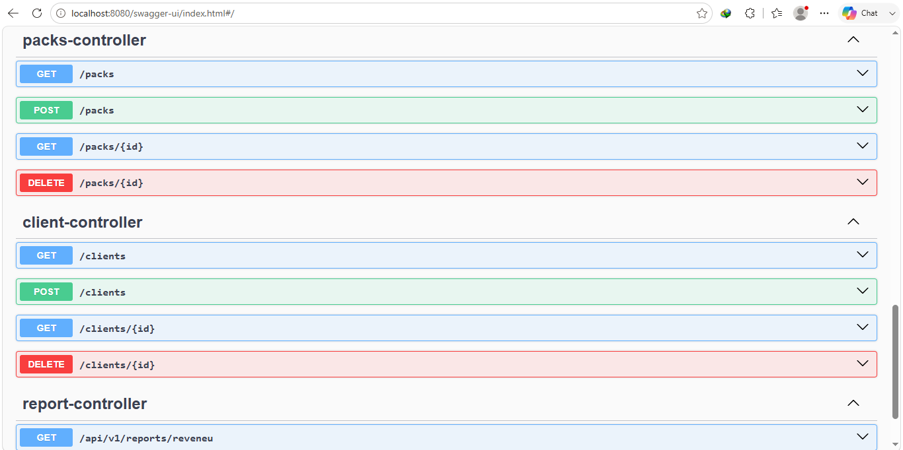
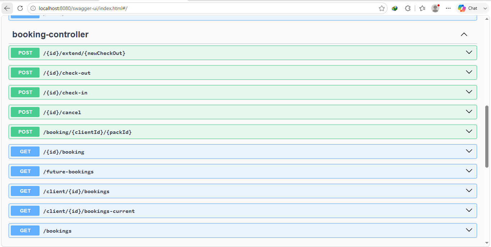
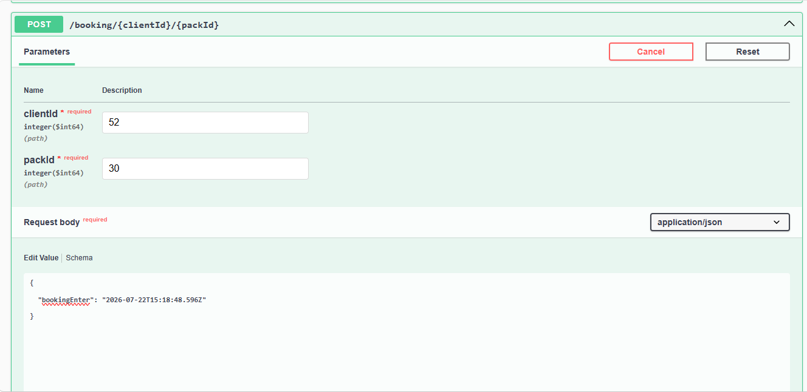
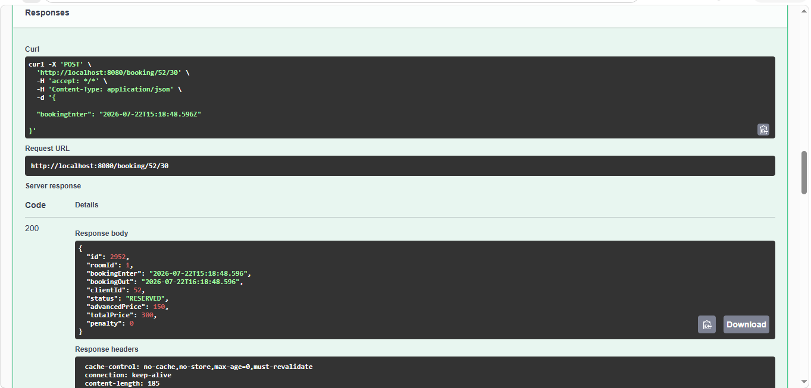
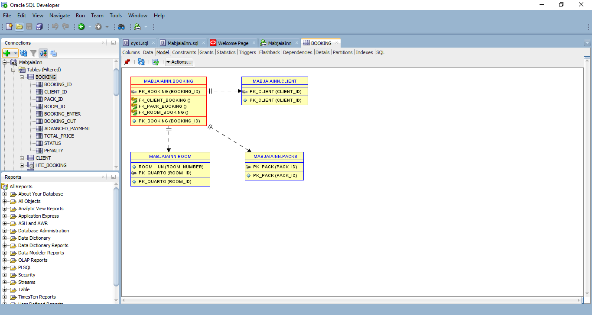

# 🏨 Guest House API


A RESTful API for managing a Guest House, built with **Java 26** and **Spring Boot**. This project provides a backend solution for managing guests, rooms, accommodation packages, and bookings while enforcing business rules for room availability, check-in, check-out, and cleaning periods.

## 🚀 Features

- 👤 Guest Management (CRUD)
- 🛏️ Room Management (CRUD)
- 📦 Package Management (CRUD)
- 📅 Booking Management
- ✅ Guest Check-in
- 🚪 Guest Check-out
- 🧹 Automatic Room Cleaning Workflow
- 🔍 Room Availability Validation
- 📌 Booking Status Management
- ⚠️ Global Exception Handling
- 📖 Interactive API Documentation with Swagger/OpenAPI
- 🧪 Unit Testing with JUnit 5 & Mockito
- 🌐 RESTful API Architecture
- 🔐 Authentication (JWT) and role-based authorization with Spring Security (ADMIN, GESTOR, CLIENTE)

---

## 🛠️ Tech Stack

- Java 26
- Spring Boot
- Spring Data JPA
- Hibernate
- Oracle Database
- Maven
- Springdoc OpenAPI (Swagger UI)
- JUnit 5
- Mockito

---

## 📁 Project Structure

```text
src
├── controller
├── service
├── repository
├── model
├── dto
├── exception
├── config
└── resources
```

---

## ⚙️ Getting Started

### Prerequisites

- Java 26
- Maven
- Oracle Database

### Clone the Repository

```bash
git clone https://github.com/linnkjoe/guest-house-api.git
```

### Navigate to the Project

```bash
cd guest-house-api
```

### Configure the Database

Update the `application.properties` file:

```properties
spring.datasource.url=jdbc:oracle:thin:@localhost:1521:xe
spring.datasource.username=username
spring.datasource.password=password

spring.jpa.hibernate.ddl-auto=update
```

### Run the Application

```bash
mvn spring-boot:run
```

The API will be available at:

```
http://localhost:8080
```

---

## 📖 API Documentation

After starting the application, access the interactive Swagger UI:

```
http://localhost:8080/swagger-ui/index.html
```

Or access the OpenAPI specification:

```
http://localhost:8080/v3/api-docs
```

---

## 📌 Main Endpoints

| Resource | Endpoint |
|----------|----------|
| Guests | `/guests` |
| Rooms | `/rooms` |
| Packages | `/packages` |
| Bookings | `/bookings` |

---

## 🔐 Security

Authentication is stateless: `POST /auth/login` with `{"username": "...", "password": "..."}` returns a JWT (`token`, `role`, `clientId`, ...). Send it on every request as `Authorization: Bearer <token>`. Authorization is declared per endpoint with `@PreAuthorize` in each controller.

**Setup**

1. Run the required database scripts once in Oracle: `database/security-schema.sql` for a new security schema, `database/manager-account-enabled-migration.sql` if upgrading manager accounts, `database/manager-first-login-password-migration.sql` to enable forced first-login password changes, `database/booking-prepayment-migration.sql` to add booking expiry/payment fields, `database/pack-catalog-image-promotion-migration.sql` to add package request counts, discounts, and image storage, `database/about-page-migration.sql` to create the editable About page, `database/contact-messages-migration.sql` for the client-to-staff message inbox, `database/contact-message-replies-migration.sql` to enable subject conversations with replies from both sides, `database/staff-contact-message-migration.sql` to allow staff-initiated conversations, and `database/staff-username-domain-migration.sql` to update existing Admin/Gestor usernames. Run contact migrations after the base contact-messages migration, in the order listed. Check and resolve username collisions before running the staff username migration. The project uses `ddl-auto=validate`.
2. Optionally set `JWT_SECRET` (32+ characters) and `BOOTSTRAP_ADMIN_PASSWORD`. If the admin password is not set, the first `ADMIN` (`admin@mbj.inn`) is created at startup with a random password written once to the log. Bootstrap usernames without a domain are automatically given the `@mbj.inn` suffix; configured usernames with a different domain are rejected.
3. Existing clients get a login account at startup (e-mail + their current password, now stored as a BCrypt hash).
4. In Swagger UI, call `/auth/login`, then use **Authorize** with the token.

**Accounts:** Admin and Gestor usernames must end in `@mbj.inn` (case-insensitive when created; stored in lowercase); the database migration updates existing staff usernames, which should then sign in using the new username. `ADMIN` creates managers with `POST /users`; the API generates a temporary password, returned once in the create response. The manager must change it at first login, and other API operations remain blocked until the password is changed. New administrator accounts use a password and confirmation supplied by the creating admin. `CLIENTE` accounts are created together with the client in `POST /clients` or via self-registration; both flows require password confirmation and continue to use their normal personal e-mail addresses.

**Who can call what**

| Endpoint | ADMIN | GESTOR | CLIENTE |
|----------|:-----:|:------:|:-------:|
| `POST /auth/login` | public | public | public |
| `GET/POST /users` | ✅ | ❌ | ❌ |
| `PATCH /users/{id}/enabled` (manager accounts only) | ✅ | ❌ | ❌ |
| `PUT /users/me/password` | ✅ | ✅ | ✅ |
| `GET /api/v1/reports/revenue` (`/reveneu` legacy alias) | ✅ | ❌ | ❌ |
| `GET /clients`, `POST /clients`, `DELETE /clients/{id}` | ✅ | ✅ | ❌ |
| `GET /clients/{id}` | ✅ | ✅ | own record |
| `GET /bookings`, `GET /future-bookings` | ✅ | ✅ | ❌ |
| `POST /{id}/check-in`, `/{id}/check-out` | ✅ | ✅ | ❌ |
| `POST /{id}/extend/{newCheckOut}` | ✅ | ✅ | own bookings |
| `POST /booking/{clientId}/{packId}` | ✅ | ✅ | only for own `clientId` |
| `GET /{id}/booking`, `POST /{id}/cancel` | ✅ | ✅ | own bookings |
| `GET /client/{id}/bookings`, `/client/{id}/bookings-current` | ✅ | ✅ | own `id` |
| `GET /packs`, `GET /packs/{id}` | ✅ | ✅ | ✅ |
| `POST /packs`, `DELETE /packs/{id}` | ✅ | ❌ | ❌ |
| `GET /rooms/available` (`/avalable` legacy alias) | ✅ | ✅ | ✅ |
| `GET /rooms`, `GET /rooms/{id}`, `GET /rooms/occupied` (`/ocupied` legacy alias) | ✅ | ✅ | ❌ |
| `POST /rooms`, `PUT /update/room`, `PATCH /{id}/clean`, `/{id}/available`, `/{id}/maintenance` | ✅ | ❌ | ❌ |

Responses: `401` without a valid token, `403` when the role (or ownership) is not allowed.

---

## 📖 Booking Workflow

1. A client chooses a stay and a simulated payment method (card, M-Pesa or e-Mola). The API records the existing 50% advance payment and selected method; this is a demo only and does not contact a payment provider or collect payment credentials.
2. The system assigns an available room and marks the booking `RESERVED`; cancelled bookings no longer block availability.
3. A booking remains `RESERVED` until staff explicitly confirms check-in with `POST /{id}/check-in`; that action moves it to `CHECKED_IN` and the room to `OCUPADO`.
4. If no check-in happened by the planned checkout time, the scheduled workflow marks the booking `EXPIRED` and releases the room when no other active booking needs it.
5. Perform guest check-out; the room enters `EM_LIMPEZA` for 30 minutes.
6. After cleaning, the scheduled workflow returns it to `DISPONIVEL`, or to `RESERVADO` when another active booking is assigned.
7. Staff can extend an active booking with `POST /{id}/extend/{newCheckOut}`; the API checks room conflicts and charges the configured extra-hour rate.

Booking response DTOs include both the internal `roomId` and the visible `roomNumber`. Display the room number in user-facing tables; keep `roomId` for API operations and relationships.

---

## 📸 API Documentation Preview

### Swagger UI Home



---

### Booking Endpoints



---

### Create Booking



---

### API Response Example



---

### Database Schema




## 🧪 Running Tests

Execute the test suite:

```bash
mvn test
```

The project includes **14 unit tests** covering the service layer using:

- **JUnit 5** for test execution.
- **Mockito** for dependency mocking and business logic isolation.

---

## 👨‍💻 Author

**Nélio Moanga**

Computer Science Student | Java Backend Developer

- GitHub: https://github.com/linnkjoe
- LinkedIn: https://www.linkedin.com/in/linnkjoe/

---


## 🚀 Future Improvements

- Docker support
- CI/CD pipeline
- Integration tests
- Pagination and filtering
- Cloud deployment (AWS)

---

⭐ Feel free to contribute, open issues, or suggest improvements!


## Auto cadastro, extras e estadias personalizadas

Executar `database/packs-customization-schema.sql` uma vez antes de arrancar (o projecto usa `ddl-auto=validate`).
Em instalacoes existentes, executar tambem `database/pack-catalog-image-promotion-migration.sql` para ativar contagem de pedidos, descontos promocionais e fotografias dos pacotes.
Executar `database/about-page-migration.sql` para criar a pagina Sobre nos com o endereco e contacto Mabjaia Inn predefinidos; o Admin pode atualizar o texto, os dados de contacto e a fotografia na aplicacao.
Executar tambem `database/contact-messages-migration.sql` para permitir que clientes autenticados enviem mensagens e que Admin/Gestor as respondam.
Executar `database/contact-message-replies-migration.sql` depois da migração anterior para organizar mensagens por assunto e permitir respostas de ida e volta entre cliente e equipa; as respostas existentes são preservadas.
Executar `database/staff-contact-message-migration.sql` depois das migrações de mensagens para habilitar o contacto iniciado pela equipa a partir das listas de reservas e clientes.
O pacote `Demo - Aviso de checkout` é criado automaticamente. Para testar o alerta sem esperar uma hora, faça uma reserva e check-in com esse pacote; depois ajuste apenas a reserva de teste no Oracle para checkout em 13 minutos: `UPDATE BOOKING SET BOOKING_OUT = SYSTIMESTAMP + INTERVAL '13' MINUTE WHERE BOOKING_ID = <ID_DA_RESERVA> AND STATUS = 'CHECKED_IN'; COMMIT;`. O aviso deve surgir quando faltarem 10 minutos, aproximadamente 3 minutos depois do ajuste. Faça o check-out da reserva de teste para libertar o quarto.
Em instalacoes existentes, executar `database/staff-username-domain-migration.sql` para atualizar os utilizadores Admin/Gestor para o dominio `@mbj.inn`; resolver colisões antes da migração. Os clientes continuam a usar os seus e-mails pessoais.
No primeiro arranque são criados os extras (ar condicionado, piscina, atendimento VIP) e as estadias **Summer** e **VIP Stay**; os preços ajustam-se na aplicação.

| Endpoint | Admin | Gestor | Cliente |
|---|---|---|---|
| `POST /auth/register`, `GET /auth/email-available` | público | público | público |
| `POST /users` (gestores/admins) | ✅ | ❌ | ❌ |
| `POST /clients` | ✅ | ✅ | ❌ |
| `POST /packs`, `PUT /packs/{id}` | ✅ | ✅ | ❌ |
| `DELETE /packs/{id}` | ✅ | ❌ | ❌ |
| `GET /features` | todos | todos | só ativos |
| `POST/PUT /features` | ✅ | ✅ | ❌ |
| `DELETE /features/{id}` | ✅ | ❌ | ❌ |
| `POST /custom-packs/quote` | ✅ | ✅ | ✅ |
| `/clients/{id}/custom-packs` (GET/POST/PUT/DELETE) | ✅ | ✅ | só o próprio |
| `POST /booking/{clientId}/custom/{customId}` | ✅ | ✅ | só o próprio |

Preço personalizado = estadia mais barata + extras que ela não inclui + horas adicionais × `app.pricing.extra-hour-rate`.
# Login Google

O Google usa o fluxo OAuth 2.0 Authorization Code; o segredo do cliente fica apenas no backend.

1. Crie um OAuth Client ID do tipo **Web application** no Google Cloud Console.
2. Em **Authorized JavaScript origins**, adicione `http://localhost:5173`.
3. Em **Authorized redirect URIs**, adicione exatamente `http://localhost:5173/backend/auth/google/callback`.
4. Configure `GOOGLE_CLIENT_ID`, `GOOGLE_CLIENT_SECRET` e `GOOGLE_REDIRECT_URI` no ficheiro `.env` na raiz deste projeto. O Spring Boot carrega-o ao iniciar a API. Nunca coloque o segredo no frontend nem versione o `.env` ou o JSON de credenciais.
5. Use `GOOGLE_REDIRECT_URI=http://localhost:5173/backend/auth/google/callback` e `GOOGLE_FRONTEND_REDIRECT_URI=http://localhost:5173/`. Para produção, atualize as URLs para os domínios HTTPS públicos; o URI de redirecionamento no Google e `GOOGLE_REDIRECT_URI` devem corresponder exatamente.

O backend valida state, nonce, assinatura, emissor, audiência, validade e e-mail verificado do token Google. Novos clientes informam o telefone após o retorno OAuth. Contas Admin e Manager continuam a usar a autenticação normal por palavra-passe.

### Cadastro por e-mail

No cadastro tradicional, a API envia um código de seis algarismos ao e-mail indicado. A conta só é criada e autenticada depois da confirmação; o código expira em 10 minutos e aceita até cinco tentativas. Configure o SMTP no `.env` do backend usando `MAIL_HOST`, `MAIL_PORT`, `MAIL_USERNAME`, `MAIL_PASSWORD` e `MAIL_FROM` (veja `.env.example`). No Gmail, use uma palavra-passe de aplicação, não a palavra-passe normal da conta, e remova os espaços de formatação. `MAIL_FROM` deve ser a conta autenticada ou um alias autorizado pelo provedor. O segredo SMTP deve permanecer apenas no backend.
